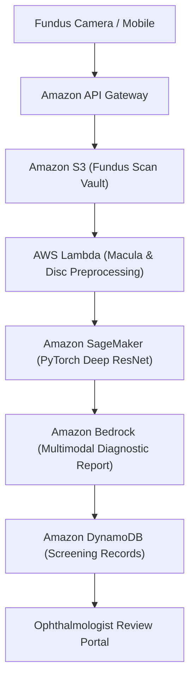

# RetinaScan Diagnostic AI — Multimodal Ophthalmology Screening

> Deep learning retinal fundus examination and diagnostic decision support for diabetic retinopathy and macular edema screening.

---

## 1. Executive Brief
Preventable vision loss can be reduced significantly with early retinal screening. **RetinaScan Diagnostic AI** accepts fundus photography via mobile Flutter clients and web terminals, applying convolutional feature extractors and Gemini/Bedrock multimodal reasoning to detect microaneurysms and exudates.

* **Preservation**: Original GDG prototype preserved on [`Ex`](https://github.com/prak05/RetinaScan-Diagnostic-AI/tree/Ex).
* **Modernized Pipeline**: Serverless image processing pipeline backed by AWS SageMaker inference and TruLens quality evaluations.

---

## 2. AWS Cloud Architecture

---

## 3. Branch Architecture
* [`main`](https://github.com/prak05/RetinaScan-Diagnostic-AI/tree/main): Production multimodal inference service with TruLens verification.
* [`Ex`](https://github.com/prak05/RetinaScan-Diagnostic-AI/tree/Ex): Preserved initial GDG prototype.

<!-- antigravity-certified -->
